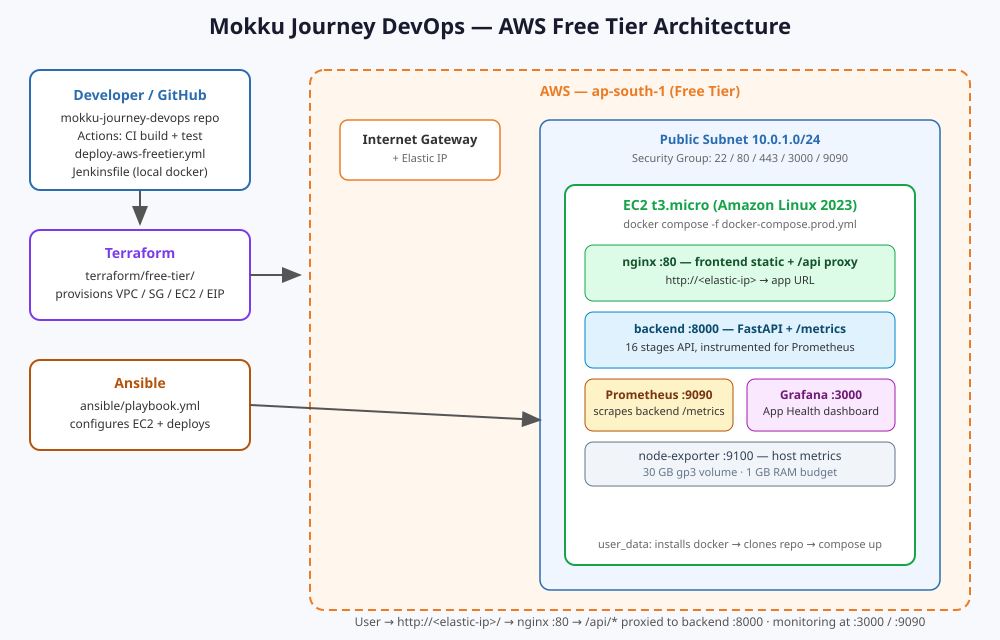

# 🛕 Mokku Journey DevOps

> **B.Tech Dream Achieved. Mokku Fulfilled. Govinda Govinda!**
>
> శ్రీ వేంకటేశ్వర స్వామి వారి ఆశీస్సులతో రాజా తన మొక్కును పూర్తి చేసుకున్నాడు. గోవిందా! గోవిందా!

**Mokku Journey DevOps** is a full-stack devotional web app *and* a complete
DevOps practice platform: it tells Raja's pilgrimage from Muddanur to Tirumala
in 16 cinematic stages, and it ships with a real, deployable toolchain —
Git, GitHub, Docker, Jenkins, GitHub Actions, Terraform, Ansible, Kubernetes,
Helm, Prometheus, and Grafana.

## Live demo

| Item | URL |
|---|---|
| Web app | `http://<EC2_PUBLIC_IP>/` *(filled after deployment — see below)* |
| API health | `http://<EC2_PUBLIC_IP>/api/health` |
| Grafana | `http://<EC2_PUBLIC_IP>:3000` | admin login; password from your `.env` (`GRAFANA_ADMIN_PASSWORD`) |
| Prometheus | `http://<EC2_PUBLIC_IP>:9090` |
| GitHub repo | `https://github.com/giriboinar/mokku-journey-devops` |

> Placeholders like `<EC2_PUBLIC_IP>` and `giriboinar` must be
> replaced with your real values. Nothing here is pre-deployed.

## Project story

Raja, a young man from the village of **Muddanur**, made a vow: *if he passed
his B.Tech, he would travel to Tirumala and offer his hair (mokku) to Lord
Venkateswara Swamy.* He passed — and this application tells his complete
pilgrimage, stage by stage, in a cinematic anime style:

1. Celebrating his B.Tech result and remembering the vow
2. Preparing in Muddanur village (backpack, railway ticket, morning departure)
3. Muddanur Railway Station → boarding the passenger train
4. Train journey Muddanur → Tirupati (animated countryside, progress indicator)
5. Arrival at Tirupati station
6. Auto-rickshaw to the Srivari Mettu trekking entrance
7. Srivari Mettu entrance and the climb begins
8. Climbing the Seven Hills (seven milestones, devotional messages)
9. Entering Tirumala, grateful and emotional
10. Kalyanakatta tonsure hall — the vow fulfilled (respectful, non-graphic)
11. Free (Sarva) darshan queue
12. Temple entrance and darshan areas
13. **Main darshan of Lord Venkateswara Swamy** — the emotional climax
14. Tirumala laddu prasadam counter — *"My vow is fulfilled."*
15. Return journey to Tirupati → Muddanur
16. Homecoming — *"B.Tech Dream Achieved. Mokku Fulfilled. Govinda Govinda!"*

Every stage has its own anime illustration, Telugu + English narration,
journey progress tracking, and replay controls.

## Architecture



**Deployable path (AWS Free Tier):** GitHub repo → Terraform (`terraform/free-tier/`)
provisions a VPC + public subnet + EC2 `t3.micro` + Elastic IP → EC2 user_data
(or Ansible) installs Docker and runs `docker-compose.prod.yml`:
**nginx :80** (static frontend + `/api` reverse proxy) → **FastAPI backend :8000**
(`/api/*`, `/metrics`) → **Prometheus :9090** → **Grafana :3000**, plus
**node-exporter :9100** for host metrics.

A reference production design (EKS + ALB + Helm) also exists as SVG:
[docs/architecture-diagram.svg](docs/architecture-diagram.svg) — portfolio
architecture only, **not** Free Tier.

## Repository structure

```
mokku-journey-devops/
├── frontend/                        # Static HTML/CSS/vanilla-JS app (16 stages)
│   └── nginx.prod.conf              # Prod nginx: static + /api → backend proxy
├── backend/                         # FastAPI: /api/health, /api/stages, /api/config, /metrics
├── java-service/                    # Optional Spring Boot demo module (Maven)
├── docker-compose.yml               # Local dev stack (backend + frontend + optional java)
├── docker-compose.prod.yml          # Production stack for EC2 (nginx, backend, prometheus, grafana, node-exporter)
├── terraform/
│   ├── free-tier/                   # ✅ THE deploy path: VPC, SG, t3.micro, EIP, user_data
│   ├── modules/                     # Reference EKS/ALB architecture (NOT Free Tier — not applied)
│   └── environments/                # Reference envs (dev/staging/production — not applied)
├── ansible/                         # Alternative deploy path: configures EC2 + docker compose
│   ├── inventory/hosts.yml          # ← fill in your EC2 IP + key
│   └── playbook.yml
├── .github/workflows/
│   ├── ci.yml                       # CI on every push: build, pytest, docker build
│   ├── deploy-aws-freetier.yml      # ✅ Terraform deploy to Free Tier EC2 (manual or on tf changes)
│   ├── deploy-staging.yml           # Reference: Helm → staging EKS
│   └── deploy-production.yml        # Reference: Helm → production EKS (approval gate)
├── Jenkinsfile                      # Declarative pipeline: test → build → scan → push → deploy → smoke → rollback
├── helm/raja-journey/               # Reference Helm chart (EKS path)
├── k8s/                             # Reference raw manifests (EKS path)
├── monitoring/
│   ├── prometheus/prometheus.yml    # ✅ Scrape config for the prod stack
│   ├── grafana/provisioning/        # ✅ Datasource + "Mokku Journey — App Health" dashboard
│   └── dashboards/                  # Reference dashboards (EKS path)
├── scripts/
│   ├── smoke-test.sh                # API smoke tests (pipeline gate)
│   └── verify-deploy.sh             # ✅ Post-deploy verification: ./verify-deploy.sh <public-ip>
└── docs/
    ├── architecture-free-tier.svg   # ✅ Deployable architecture
    └── architecture-diagram.svg     # Reference EKS architecture
```

## Prerequisites

- **Local:** Docker + Docker Compose v2, Git
- **AWS deploy:** an AWS account, an EC2 key pair in your region, Terraform ≥ 1.5
- **Ansible path:** Ansible ≥ 2.15, SSH access to the instance
- **CI/CD:** GitHub repo + (for AWS deploys) one-time OIDC IAM role setup — see below

## Quickstart (local)

```bash
git clone https://github.com/giriboinar/mokku-journey-devops.git
cd mokku-journey-devops
```

**Development stack** — backend + frontend with live code mounting:

```bash
docker compose up --build
```

Open the app at http://localhost:8080 and the API health check at
http://localhost:8000/api/health.

**Production stack** — mirrors the EC2 deployment (nginx + backend +
Prometheus + Grafana). Needs a `.env` file first:

```bash
cp .env.example .env
```

Edit `.env` and set `GRAFANA_ADMIN_PASSWORD` to a strong password, then:

```bash
docker compose -f docker-compose.prod.yml up -d --build
```

Open the app at http://localhost/, Grafana at http://localhost:3000 and
Prometheus at http://localhost:9090. Verify everything with:

```bash
./scripts/verify-deploy.sh 127.0.0.1
```

**Dev vs prod in one line:** `docker-compose.yml` is for coding (source files
mounted live, ports per service); `docker-compose.prod.yml` is for running
the real deployment (nginx reverse proxy on port 80, monitoring included,
no live mounts).

## AWS Free Tier deployment

**Step 1 — key pair.** In the AWS Console → EC2 → Key Pairs, create a key pair
(e.g. `mokku-key`) in your region and save the `.pem`.

**Step 2 — provision + deploy with Terraform:**

```bash
cd terraform/free-tier
terraform init
terraform plan \
  -var "key_name=mokku-key" \
  -var "repo_url=https://github.com/giriboinar/mokku-journey-devops.git"
terraform apply \
  -var "key_name=mokku-key" \
  -var "repo_url=https://github.com/giriboinar/mokku-journey-devops.git"
terraform output
```

`terraform output` prints `app_url`, `api_health_url`, `grafana_url`,
`prometheus_url`, and an `ssh_command`. EC2 user_data installs Docker, clones
the repo, and starts the stack automatically (takes ~3–5 min on first boot).

**Step 3 — verify:**

```bash
./scripts/verify-deploy.sh <EC2_PUBLIC_IP>
```

**Alternative — Ansible instead of user_data:** after `terraform apply`,
edit `ansible/inventory/hosts.yml` with the Elastic IP and key path, then:

```bash
cd ansible
ansible-playbook -i inventory/hosts.yml playbook.yml \
  -e repo_url=https://github.com/giriboinar/mokku-journey-devops.git
```

## GitHub setup

1. Create an empty repo named **`mokku-journey-devops`** on GitHub.
2. Push:
   ```bash
   git remote add origin https://github.com/giriboinar/mokku-journey-devops.git
   git branch -M main
   git push -u origin main
   ```
3. Workflows run automatically: `ci.yml` on every push; `deploy-aws-freetier.yml`
   on manual dispatch or when `terraform/free-tier/**` changes on `main`.

## CI/CD

### GitHub Actions

| Workflow | Trigger | What it does |
|---|---|---|
| `ci.yml` | every push/PR | backend pytest, docker builds, secret scan |
| `deploy-aws-freetier.yml` | manual / tf changes on main | OIDC → AWS → `terraform apply` → `verify-deploy.sh` |
| `deploy-staging.yml`, `deploy-production.yml` | manual | reference Helm → EKS path (needs EKS cluster) |

**GitHub Actions OIDC setup (one time, for AWS deploys):**
1. AWS Console → IAM → Identity providers → Add provider: `token.actions.githubusercontent.com`, audience `sts.amazonaws.com`.
2. Create a role with trust policy allowing `sub: repo:giriboinar/mokku-journey-devops:*`; attach EC2/VPC permissions (lab: `AmazonEC2FullAccess`).
3. GitHub repo → Settings → Secrets and variables → Actions:
   - Secret `AWS_ROLE_TO_ASSUME` = role ARN
   - Secret `EC2_KEY_NAME` = your existing EC2 key pair name
   - Variable `AWS_REGION` = e.g. `ap-south-1`

No long-lived AWS keys — OIDC only.

### Jenkins

`Jenkinsfile` is a declarative pipeline (checkout → validate → pytest →
optional Java build → lint/scan → docker build → Trivy → push to ECR →
staging deploy → smoke tests → manual approval → production deploy → verify →
rollback on failure). To run it locally in Docker:

```bash
docker run -d --name jenkins -p 8080:8080 -p 50000:50000 \
  -v jenkins_home:/var/jenkins_home jenkins/jenkins:lts
# Create a Pipeline job pointing at this repo; add credentials:
#   aws-account-id (Secret Text), plus AWS creds / kubeconfig as needed
```

The Free Tier path intentionally does **not** push to ECR — images are built on
the EC2 host itself by `docker compose up --build`.

### Rollback

- **EC2 path:** SSH in, `cd /opt/mokku-journey-devops && git pull` (or checkout
  the previous tag) and `docker compose -f docker-compose.prod.yml up -d --build`.
- **EKS path:** `helm rollback <release> -n <namespace>` (wired into
  `deploy-production.yml` and the Jenkinsfile on smoke-test failure).

## Monitoring

| Tool | URL | Notes |
|---|---|---|
| Grafana | `http://<EC2_PUBLIC_IP>:3000` | admin login; set `GRAFANA_ADMIN_PASSWORD` in `.env` before first boot (see `.env.example`) |
| Prometheus | `http://<EC2_PUBLIC_IP>:9090` | targets: `prometheus`, `backend`, `node-exporter` |
| Dashboard | "Mokku Journey — App Health" | auto-provisioned: backend up, req/s, p95 latency, RSS memory |

The backend exposes Prometheus metrics at `/metrics` (via
`prometheus-fastapi-instrumentator`; guarded so the app starts even if the
package is missing).

## Useful commands

| Task | Command |
|---|---|
| Local dev stack | `docker compose up --build` |
| Production stack | `docker compose -f docker-compose.prod.yml up -d --build` |
| Backend tests | `cd backend && python -m pytest` |
| Tail app logs on EC2 | `ssh -i key.pem ec2-user@<ip> 'cd /opt/mokku-journey-devops && docker compose -f docker-compose.prod.yml logs -f'` |
| user_data log | `ssh ... 'sudo tail -f /var/log/user-data.log'` |
| Verify deployment | `./scripts/verify-deploy.sh <EC2_PUBLIC_IP>` |
| API smoke tests | `BASE_URL=http://<ip> ./scripts/smoke-test.sh` |
| Terraform outputs | `terraform -chdir=terraform/free-tier output` |
| Redeploy latest code | `ssh ... 'cd /opt/mokku-journey-devops && git pull && docker compose -f docker-compose.prod.yml up -d --build'` |

## Troubleshooting

| Symptom | Check |
|---|---|
| `terraform apply` fails on AMI | ensure region supports AL2023 x86_64; check `var.az` exists in `var.region` |
| Instance up but app unreachable | `ssh` in, `sudo tail /var/log/user-data.log`; `docker compose -f docker-compose.prod.yml ps` |
| `/api/health` 502 | backend container unhealthy — `docker logs mokku-journey-backend` |
| Frontend loads, stages never appear | backend not reachable via `/api` — check nginx conf mount and `docker network ls` |
| Grafana empty dashboard | wait ~1 min for provisioning; check `docker logs mokku-journey-grafana` |
| Ansible SSH fails | key path in `inventory/hosts.yml`, SG port 22, instance in `running` state |
| `terraform plan` asks for `key_name` | it has no default by design — pass `-var key_name=...` |

## Cost & Free Tier notes

While Free Tier eligible: EC2 `t3.micro` 750 hrs/mo, 30 GB EBS, 100 GB data
transfer out — **$0**. Elastic IP is free while attached to a running instance;
~$0.005/hr if left unattached (e.g. instance stopped). The EKS modules are
**not** Free Tier (EKS ~$73/mo, NAT Gateway ~$33–45/mo each, ALB ~$18–25/mo) —
they are reference architecture and are never applied by the Free Tier path.

## Security notes

- No secrets committed: AWS access uses OIDC (GitHub Actions) or your own key
  pair; Grafana password comes from the `GRAFANA_PASSWORD` env var.
- Security group defaults are lab-convenient (SSH open). Restrict before real
  use: `-var ssh_allowed_cidr=<your-ip>/32 -var monitoring_cidr=<your-ip>/32`.
- The backend's CORS is currently wide open (`allow_origins=["*"]`) — fine for
  this static frontend behind the same origin; tighten in `backend/app/main.py`
  if the API is ever exposed directly.
- Never paste `.pem` contents, AWS keys, or passwords into issues, logs, or chat.

## Cleanup

```bash
cd terraform/free-tier
terraform destroy -var "key_name=<your-keypair>" -var "repo_url=<your-repo-url>"
```

Removes instance, EIP, security group, subnet, IGW, and VPC. Confirm in the
console that no unattached Elastic IP remains (those are billed). Locally:
`docker compose -f docker-compose.prod.yml down -v` to remove containers and
the Grafana data volume.

---

*Built with devotion and DevOps. Govinda Govinda! 🙏*

